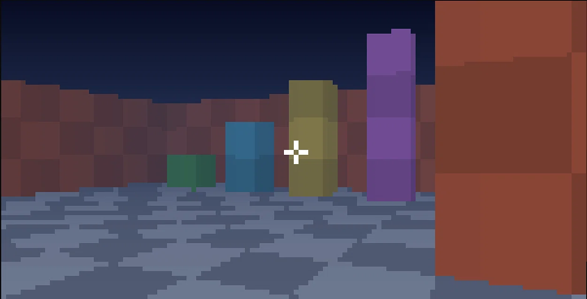
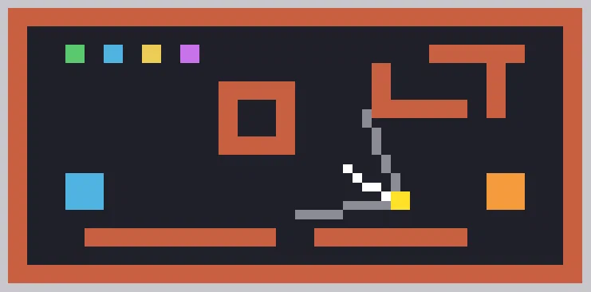

<div align="center">

# SurveEngine

### 3D-движок для командной строки Windows

**Полностью независимая реализация программного 3D-рендерера для консоли.**

<br>

<a href="#">
  
</a>
<a href="#">
  
</a>
<a href="#">
  
</a>
<a href="#">
  
</a>

</div>

---

## О проекте

**SurveEngine** — независимо разработанный 3D-движок, написанный полностью с нуля на **Python** без внешних зависимостей.

Проект создан как эксперимент: можно ли получить настоящий 3D-рендер — с перспективной проекцией, z-буфером, отсечением и освещением — в среде, которая для этого не предназначена. Ответ: можно, если выводить кадр через ANSI-цвета и полублоки `▀`.

Движок не использует OpenGL, pygame, numpy или какие-либо другие библиотеки. Вся математика, растеризация и вывод реализованы вручную на стандартной библиотеке Python.

Проект находится в активной разработке.

---

## Чем SurveEngine отличается

* Написан с нуля, без сторонних графических библиотек
* Программный рендерер: проекция, z-буфер, near-plane clipping
* Перспективно-корректная интерполяция глубины
* Освещение по нормалям граней и туман по расстоянию
* 24-битный ANSI-цвет через полублоки `▀` (два пикселя на знакоместо)
* Физика игрока: гравитация, прыжок, коллизии, «шаг» на низкие блоки
* Цветная мини-карта с конусом обзора и тремя масштабами
* Ноль зависимостей — только стандартная библиотека Python

---

## Тестирование

SurveEngine работает с картами, описанными в виде текстовых строк. Каждая клетка карты задаёт высоту блока, что позволяет строить уровни с перепадами высот, лестницами и укрытиями.

<div align="center">




<br>

<i>SurveEngine: рендер от первого лица и мини-карта с конусом обзора.</i>

</div>

---

## Текущий статус

SurveEngine находится в активной разработке. Часть систем уже работает, другие находятся в экспериментальной стадии или не завершены.

Разработка ведётся поэтапно, с фокусом на:

* Программный рендеринг
* Перспективную проекцию и z-буфер
* Освещение и туман
* Физику игрока и коллизии
* Мини-карту и HUD
* Оптимизацию вывода в консоль

---

## Сборка и запуск

### Требования

SurveEngine рассчитан на **Windows 10/11 x64** и требует установленного **Python 3.8 или новее**.

Необходимо:

* Windows 10/11 x64
* Python 3.8+ с [python.org](https://www.python.org/downloads/) (галочка «Add to PATH»)
* Терминал `cmd` или `conhost` с поддержкой ANSI-кодов
* Шрифт с символом `▀` (Consolas или Lucida Console)

Внешние библиотеки не требуются. Все зависимости — стандартная библиотека Python.

### Установка

Запустите установщик из корневой папки проекта:
Или запустите если движок уже установлен

```bat
setup.bat

или

start.bat


